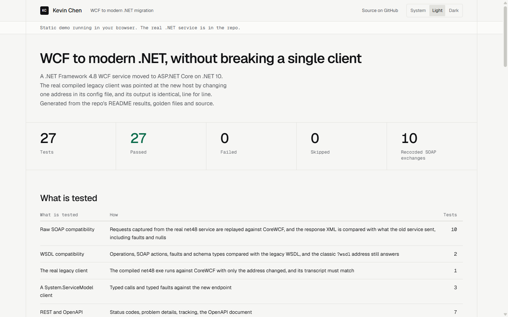

# WCF to modern .NET, without breaking a single client

A worked migration of a .NET Framework 4.8 WCF service to ASP.NET Core on modern .NET. Existing SOAP clients keep working with no code change, and new clients get a REST API with OpenAPI. Both run on one shared application layer. The service belongs to Harbour Freight Couriers, a fictional courier company, and all data and names are invented.

The code targets .NET 10. The same approach applies to .NET 8 and later.



*The results site, generated from this repo's files. Screenshot taken in headless Chrome on 4 November 2026.*

## The result

The real compiled .NET Framework client was pointed at the new host by changing one address in its config file. Its output is identical, line for line, to what it printed against the old service.

Latest run: **27 tests, 27 passed, 0 failed, 0 skipped**, with `dotnet build` at 0 warnings and 0 errors. All of it was run from a fresh clone on Windows 11.

| What is tested | How | Tests |
|---|---|--:|
| Raw SOAP compatibility | Requests captured from the real net48 service are replayed against CoreWCF, and the response XML is compared with what the old service sent, including faults and nulls | 10 |
| WSDL compatibility | Operations, SOAP actions, faults and schema types compared with the legacy WSDL, and the classic `?wsdl` address still answers | 2 |
| The real legacy client | The compiled net48 exe runs against CoreWCF with only the address changed, and its transcript must match | 1 |
| A System.ServiceModel client | Typed calls and typed faults against the new endpoint | 3 |
| REST and OpenAPI | Status codes, problem details, tracking, the OpenAPI document | 7 |
| One shared layer | Booked by SOAP and read by REST, then the reverse | 1 |
| Guards on the golden files | The files exist, cover every operation and hold the expected legacy values | 3 |

To check that these tests can actually fail, I broke the code on purpose in two ways and restored it afterwards. Correcting the `RefrenceNo` typo in one contract failed 6 tests, including the WSDL comparison and the real client. Changing the weight rounding rule failed 5 tests.

## Migration strategy

1. **Inventory.** List every operation, binding, data contract, fault and client. Find out what the clients really send, which often differs from the documentation. Here that means three operations over `basicHttpBinding`, two fault contracts and a few quirks.
2. **Contract freeze.** Treat the wire format as a public API that can no longer change. Capture real traffic and the WSDL from the running legacy service as golden files (`scripts/capture-golden.sh`), so the contract is defined by what the service does and not by what someone remembers.
3. **Separate the rules from the host.** Move validation, pricing and storage out of the WCF service class into a plain application layer with no WCF dependency. SOAP and REST become thin adapters, and the rules can finally be tested on their own.
4. **Host the same contract on CoreWCF.** Copy the contract across with its names and namespaces untouched and implement it over the application layer. Turn the golden files into tests and fix differences until they pass.
5. **Strangler rollout.** Run old and new side by side. Move clients one at a time by changing an address or a route at the proxy, starting with the lowest risk. Each move is reversible by changing the address back. New consumers start on REST from day one.
6. **Cutover.** When logs show no traffic left on the old service, stop it, keep it available for a rollback period, then retire it. SOAP itself stays for as long as any client needs it. Retiring it is a separate business decision and does not have to happen as part of this upgrade.

This demo covers steps 1 to 4 in code. Steps 5 and 6 are operational: they depend on the client's environment and cannot be proven in a repo. It also uses an in-memory store for both services, so migrating real persistence is out of scope here.

## What was kept, and why

| Kept in SOAP | Why |
|---|---|
| The `RefrenceNo` field name, typo included | Clients generated code from it. Renaming it would silently send them nulls. REST uses `reference`. |
| `GetConsignment` returns null for an unknown number, while `TrackConsignment` raises a typed fault | Inconsistent, but clients have code paths written for each. REST returns a plain 404 for both. |
| Charging per started half kilo | Existing invoices depend on it. A migration is the wrong moment to change a business rule. |
| Fault shapes, validation order and messages | Clients may show or parse them. |
| Namespace, SOAP actions and `basicHttpBinding` | They are the contract. |

What was not kept: logic inside the service class, static state and the .NET Framework runtime itself.

## Layout

```
legacy/Harbour.Legacy.Service   the old .NET Framework 4.8 WCF service, self-hosted
legacy/Harbour.Legacy.Client    the old client with its own copy of the contract, as svcutil would generate
modern/src/...Application       booking rules, no web or WCF dependency
modern/src/...Web               CoreWCF SOAP endpoint and REST API, both thin adapters
modern/tests/...Tests           xUnit tests and the golden files in Golden/
tools/GoldenCapture             records golden files from the running legacy service
```

## Live demo

[https://kevindemo.github.io/wcf-to-modern-dotnet-migration/](https://kevindemo.github.io/wcf-to-modern-dotnet-migration/)

A static results site generated from this README, the golden files and the source: test results, the legacy client transcript, the recorded SOAP traffic and code diffs. The build fails if the test table stops adding up to the stated total.

```bash
node static-demo/build.mjs
```

This needs only Node and writes `docs-site/`. Every asset path is relative, so it works under `/wcf-to-modern-dotnet-migration/`. GitHub Pages only publishes a repo's root or `docs/`, so this folder goes out through a `gh-pages` branch or an Actions workflow. It has not been deployed yet.

## Hosting the real service

The static demo needs no server. To host the real .NET service as well, the repo has a multi-stage `Dockerfile` (.NET 10, listens on `$PORT`) and a `render.yaml` blueprint for Render's free web service plan. It hosts the modern service only, as the net48 projects cannot build on Linux. This service uses an in-memory store with seeded consignments rather than SQLite, so there is no database to seed. The image itself has not been built, because Docker was not available on the machine where this was written. `dotnet publish` was run instead and the published build answered over HTTP with the same settings.

## How to run

You need Windows and the .NET 10 SDK. The net48 projects build through the `Microsoft.NETFramework.ReferenceAssemblies` package, so no targeting pack is needed. On Linux or macOS the legacy projects cannot run, and the test that needs the real exe is skipped.

```bash
dotnet build Harbour.Migration.slnx
dotnet test Harbour.Migration.slnx
```

Run the modern host:

```bash
dotnet run --project modern/src/Harbour.Consignments.Web --urls http://localhost:5080
```

- SOAP: `http://localhost:5080/ConsignmentService.svc` (WSDL at `?wsdl`)
- REST: `POST /api/consignments`, `GET /api/consignments/{number}`, `GET /api/consignments/{number}/tracking`
- OpenAPI: `http://localhost:5080/openapi/v1.json`

```bash
curl -X POST http://localhost:5080/api/consignments -H "Content-Type: application/json" -d '{"customerAccount":"AC1","pickupZone":"Z03","deliveryZone":"Z08","serviceLevel":"Express","weightKg":3.2,"items":2,"reference":"PO-1"}'
```

Run the old pair on its own by starting `legacy/Harbour.Legacy.Service/bin/Debug/net48/Harbour.Legacy.Service.exe`, then `Harbour.Legacy.Client.exe` from its own bin folder. The service uses the `Temporary_Listen_Addresses` URL that Windows reserves for all users, so it needs no admin rights. To point the client at the new host, edit the address in `Harbour.Legacy.Client.exe.config`.

The golden files are the frozen record of the legacy service and are committed. Only rerun `scripts/capture-golden.sh` if the legacy service itself changes on purpose.

## What a client gets in the Upgrade offer

The .NET Framework / WCF to .NET 8 Upgrade starts with a fixed-price assessment, and the scope and price of any further work are agreed in writing before it starts:

1. An inventory of your services, bindings, contracts, clients and framework dependencies, with what can move directly and what needs work. Some WCF features have no CoreWCF equivalent, and you would hear that up front.
2. A migration plan in the order above, with the risks named and a rollback path at each step.
3. A proof of concept on one real service if the assessment recommends it: the contract captured as golden tests and hosted on modern .NET.
4. For the implementation, the same safety net as this repo, so existing clients are tested against recorded behaviour rather than assumptions.

Details and contact: [kevindemo.github.io](https://kevindemo.github.io).
